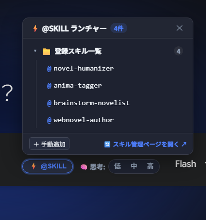
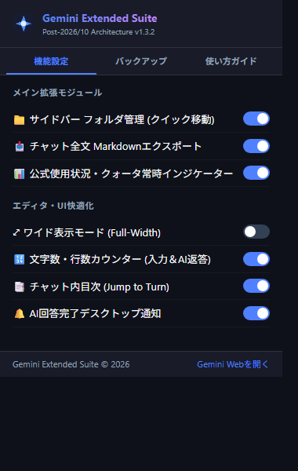
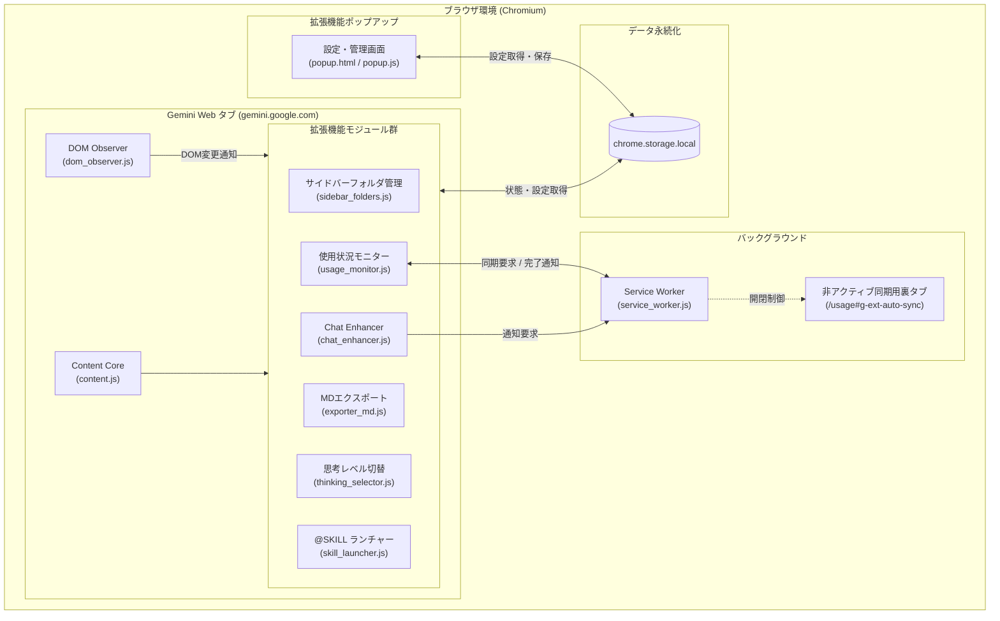

# Gemini Extended Suite (Manifest V3)

<div align="center">


**Gemini Web UI 向け 包括的作業支援ブラウザ拡張機能**

[](https://developer.chrome.com/docs/extensions/mv3/intro/)
[](manifest.json)
[](https://gemini.google.com)
[](#)

</div>

---

> [!WARNING]
> **ご注意 / お願い**
> 本リポジトリは自分用のお試しプロジェクト（WIP）です。不具合や未実装機能が多数含まれています。

## 1. プロジェクト概要

**Gemini Extended Suite** は、Google の AI サービス「Gemini Web インターフェース（`https://gemini.google.com`）」におけるクリエイティブワーク、長編小説・シナリオ執筆、プログラミング、学術リサーチを飛躍的に快適化するオールインワンのブラウザ拡張機能（Manifest V3 準拠）です。

Gemini の頻繁な UI 更新や SPA（Single Page Application）の非同期 DOM レンダリングに追従する自己修復型 DOM Observer を核とし、スレッドのフォルダ階層整理、スレッド名自動取得対応の高品質な思考プロセス（Thinking）付き Markdown エクスポート、思考レベル（低/中/高）ワンクリック切替、登録済みスキル自動取得対応のツリー型 `@SKILL` ランチャー、公式使用制限（`/usage`）のリアルタイム監視、目次ジャンプ、入力および返答のリアルタイム文字数カウントなどの先進的な機能を提供します。

---

## 2. UI プレビュー & スクリーンショット

### @SKILL ランチャー（ツリーポップアップ & 一括挿入）
チャット入力欄横の `[ ⚡ @SKILL ]` ボタンをクリックすると、`/customize/skills` から自動取得した登録済みスキル一覧が階層ツリーで展開されます。クリックで `@スキル名` と改行が一括挿入されます。

<div align="center">



</div>

### スキル自動取得（`/customize/skills` 連携）
Gemini公式のスキル管理ページ（`/customize/skills`）を開くだけで、インストール済みスキルを自動検知してローカルストレージへ即時同期・保存します（推奨テンプレートの誤取得は自動除外）。


### ポップアップ管理画面 (Popup Interface)
拡張機能アイコンをクリックすることで、各機能の有効/無効のワンクリック切り替え、フォルダ構成・設定の JSON バックアップ/リストアが可能です。

<div align="center">



</div>

---

## 3. システムアーキテクチャ & 設計仕様

本拡張機能は Google Chrome および Chromium 系ブラウザ（Microsoft Edge 等）の最新仕様である **Manifest V3** に完全準拠しています。



### アーキテクチャ設計原則
1. **完全ローカル完結型 (Zero External Telemetry)**
   - ユーザーのチャット内容、プロンプト、アカウント情報が外部サーバーへ送信されることは一切ありません。すべてのデータはブラウザの `chrome.storage.local` に安全に保管されます。
2. **自己位置修復型 DOM マウント (Resilient DOM Observer)**
   - Gemini Web の高速な非同期ロードや F5 リロード時にも、競合（レースコンディション）を回避してサイドバー上部やチャットヘッダーに要素を安全に再マウントします。
3. **裏タブ非同期同期方式 (Safe Hidden Tab Auto-Sync)**
   - クロスオリジン制約や iframe 埋め込み時の `DOMException` を完全根絶するため、Service Worker 経由で非アクティブな裏タブを一時起動し、公式使用量データをスクレイピング後、即座にクローズする安全な同期フローを採用しています。

---

## 4. 詳細機能仕様

### ① サイドバー フォルダ管理 (`sidebar_folders.js`)
- **フォルダ分類**: サイドバー上部に「＋ 新規フォルダ」ボタンを追加。
- **ワンクリック移動**: 各スレッド項目のホバーメニューに「📁」ボタンを配置。クリックでポップオーバーが開き、指定フォルダへ即座に移動。
- **アコーディオン開閉**: フォルダごとにスレッド群の展開/折りたたみが可能。開閉状態は自動保存。
- **タイトル完全永続化 & リアルタイム同期**: スレッドタイトルをストレージに永続化するとともに、Gemini 公式 UI 上でスレッド名が変更された際もフォルダ内の表示名を即座に自動同期。

### ② Markdown 全文エクスポート (`exporter_md.js`)
- **スレッド名自動取得 & ファイル名保存**: サイドバーのアクティブ要素、内部キャッシュ、URL、チャット冒頭文等から現在の正式なスレッド名を多段階で自動特定。モーダルに表示し `${スレッド名}.md` で直接保存（日付プレフィックスを廃止しスレッド名単体で出力）。
- **ワンクリック保存**: 画面右上ツールバーに「📥 MD保存」ボタンを注入。
- **思考プロセス（Thinking）抽出**: Gemini の Thinking（折りたたみ思考ログ）を含む/除外するトグルに対応。
- **構文抽出の最適化**:
  - コードブロック（言語名ラベル、インデントの完全保持、インラインコードとの競合防止）
  - テーブル（Markdown 表形式への整形）
  - 数式ブロック・インライン数式（KaTeX / MathJax / Annotation からの TeX ソース抽出）
  - ハイパーリンク、引用ブロック、順序付きリスト、ネストされたリスト、水平線、取り消し線の正確な変換
- **YAML フロントマター**:
  - タイトル、エクスポート日時、URL、メッセージ数、Thinkingの有無を YAML ヘッダーとして自動付加。
- **ファイル名サニタイズ**: OS 依存の禁止文字（`\ / : * ? " < > |`）を安全に置換。

### ③ 思考レベル (Thinking Level) クイック切替 (`thinking_selector.js`)
- **3段階思考レベルのワンクリック選択**: 思考レベルの「低（安値）」「中」「高（高値）」を、入力欄下部（モデル選択ボタンの左隣）に配置されたコンパクトなボタングループ `[ 🧠 思考: 低 | 中 | 高 ]` から瞬時に切り替え。
- **公式メニュー自動操作**: ボタンを押すだけで、背後の公式プルダウンを自動かつ高速に選択して設定を反映。
- **アクティブ状態の自動同期**: 公式メニューから手動変更された場合でも、現在の思考レベルを自動検知してボタンをハイライト。

### ④ @SKILL ランチャー（ツリーポップアップ & 自動同期） (`skill_launcher.js`)
- **`/customize/skills` からの自動取得**: スキル管理ページを開くだけで、登録済みスキル名をDOMから正確に抽出して `chrome.storage.local` へ自動保存。更新時にはトースト通知を表示。
- **スマート除外フィルター**: 「推奨（未インストール）」セクションのカードやUI固定文言、説明文などのノイズを多段階ヒューリスティックで完全除外。
- **階層ツリーポップアップUI**: チャット入力欄横の `[ ⚡ @SKILL ]` ボタンをクリックすると、プレフィックス別グループ＋フラット一覧で階層表示。
- **「@スキル名 ＋ 改行」一括挿入**: スキルをクリックするだけで入力欄へ `@スキル名\n` を注入し、直後の行へ自動でキャレット（カーソル）をフォーカス移動。
- **手動管理・個別削除**: ポップアップ内から「＋ 手動追加」でのスキル登録や、不要なスキルの個別削除（`✕`）にも対応。

### ⑤ 公式使用状況・クォータ常時インジケーター (`usage_monitor.js`)
- **公式連携**: `https://gemini.google.com/usage` から正確なリアルタイムデータを取得。
- **視認性の高いインジケーター**:
  - 画面ヘッダーに使用状況バーを常時表示。
  - 現在のメッセージ使用数 / 上限、リセットまでの残り時間、1週間の上限使用率を表示。
  - 残り使用量に応じてカラーが自動変化（安全: 緑、注意: 黄、警戒: 赤）。
- **詳細ポップオーバー**: クリック時にモデル別の使用枠やリセット時刻を一覧表示。

### ⑥ Chat Enhancer (`chat_enhancer.js`)
- **📑 チャット内目次 (Jump to Turn)**:
  - 会話が長くなっても、ユーザーの質問見出しを右端にフローティング目次として一覧化。
  - ライブDOMから親要素・スクロールターゲットを動的解決し、SPAのDOM差し替え後でも最新ターンへ確実にスムーズスクロール。
  - 同一プレフィックスのプロンプト重複除外問題を解消し、全ターンを正確にリスト化。
- **⤢ フルワイド表示モード (Full-Width Mode)**:
  - デフォルトの狭いチャット幅を解除し、大画面モニターで 85%〜100% のワイドレイアウトに切り替え。
- **🔢 リアルタイム文字数・行数カウンター**:
  - **入力エリア**: 入力中の文字数・行数をプロンプトボックス下部にリアルタイム表示。
  - **AI返答メッセージ**: 各返答フッターに、本文および思考プロセスの文字数をカウントして目立たず表示。
- **🔔 AI回答完了デスクトップ通知**:
  - 長文生成や深い思考（Thinking）中に別タブで作業していても、生成完了時に OS のデスクトップ通知でお知らせ。

### ⑦ ポップアップ設定 & バックアップ (`popup/`)
- **機能別トグル**: 利用シーンに合わせて各機能を個別に ON/OFF 可能。
- **JSON バックアップ & リストア**:
  - 整理したフォルダツリーや設定情報をワンクリックで `.json` ファイルとしてローカル保存。
  - PC 移行やブラウザプロファイルの再構築時にも即座に復元可能。

---

## 5. ファイル・ディレクトリ構成

```text
gemini-extended-suite/
├── .gitignore                      # 除外ファイル設定 (環境変数、node_modules、キャッシュ等)
├── manifest.json                   # Chrome拡張機能マニフェスト (Manifest V3)
├── README.md                       # 本仕様書
├── background/
│   └── service_worker.js          # 常駐 Service Worker (通知、裏タブ同期管理)
├── content/
│   ├── content.js                 # 各モジュールの統合エントリーポイント
│   ├── dom_observer.js            # 動的DOM監視 & レディ判定モジュール
│   ├── modules/
│   │   ├── chat_enhancer.js       # 目次、ワイド化、文字数カウント、通知
│   │   ├── exporter_md.js         # Markdown全文エクスポートエンジン
│   │   ├── sidebar_folders.js     # サイドバーのフォルダ整理モジュール
│   │   ├── skill_launcher.js      # @SKILL ランチャー（ツリーポップアップ & 自動同期）
│   │   ├── thinking_selector.js   # 思考レベル3段階クイック切替モジュール
│   │   └── usage_monitor.js       # 公式/usage連携クォータモニター
│   └── styles/
│       ├── components.css         # フォルダUI、目次、スキルツリー等のスタイル
│       ├── injected_theme.css     # Gemini本体への注入テーマ微調整
│       └── main.css               # 全体共通レイアウト・ワイド化スタイル
├── icons/
│   ├── icon-16.png                # 拡張機能アイコン (16x16)
│   ├── icon-48.png                # 拡張機能アイコン (48x48)
│   └── icon-128.png               # 拡張機能アイコン (128x128)
├── popup/
│   ├── popup.html                 # 設定画面ポップアップ HTML
│   ├── popup.css                  # 設定画面スタイルシート
│   └── popup.js                   # 設定トグル・バックアップ/インポート制御
└── docs/
    └── screenshots/
        ├── popup-features.png         # ポップアップ画面スクリーンショット
        ├── skill-launcher-popover.png # @SKILL ランチャーツリー画面
        └── gemini-skills-page.png     # Gemini スキル管理画面
```

---

## 6. インストール・読み込み手順（開発者モード）

### Google Chrome または Microsoft Edge での導入

1. ブラウザを開き、拡張機能管理ページにアクセスします:
   - **Google Chrome**: アドレスバーに `chrome://extensions/` を入力
   - **Microsoft Edge**: アドレスバーに `edge://extensions/` を入力
2. 画面右上（または左メニュー）の **「デベロッパー モード（開発者モード）」** を有効にします。
3. **「パッケージ化されていない拡張機能を読み込む」**（Edge では「展開して読み込む」）をクリックします。
4. 本プロジェクトのルートフォルダ（`gemini-extended-suite`）を選択します。
5. ツールバーの拡張機能一覧からピン留めを行うと、アイコンからいつでも設定にアクセスできます。
6. `https://gemini.google.com` を開き（既に開いている場合は F5 で更新）、拡張機能が正常に適用されていることを確認してください。

---

## 7. 更新履歴 (Changelog)

- **v1.6.0** (2026-11-10)
  - **目次（TOC）ジャンプ機能の抜本修正 (`chat_enhancer.js`)**: SPAのDOM差し替えに対応したライブDOM動的ターゲット解決、同一プロンプト重複除外バグの撤廃、高さ0要素対策のスムーズスクロールを実装。
  - **@SKILL ランチャーの刷新 (`skill_launcher.js`, `components.css`)**: `/customize/skills` からの登録済みスキル自動抽出＆保存、インデント線付きツリーポップアップメニュー、クリックによる「@スキル名＋改行」の一括入力欄挿入、手動追加・削除機能を追加。
  - **Markdown保存ファイル名の最適化 (`exporter_md.js`)**: 保存ファイル名から日時プレフィックスを廃止し、スレッド名単体（`${スレッド名}.md`）で直接出力するように仕様変更。
  - **安定性向上**: Service Worker のタブ作成エラー（ドラッグ時等）耐性向上、コンテキスト切断ガード（`safeStorage`）の実装。
- **v1.5.0** (2026-10-30)
  - **公式 `@SKILL` ワンクリック呼び出し機能の新設 (`skill_launcher.js`)**: チャット入力欄下部に `[ ⚡ @SKILL ]` ボタンを追加し、ワンクリックで `@` 注入および公式 SKILL サジェストメニューを即時起動可能に。
  - **Markdownエクスポートのリッチ要素変換強化 (`exporter_md.js`)**: 数式（KaTeX / MathJax / TeX Annotation）、ハイパーリンク、引用ブロック、順序付きリスト、ネストされたリスト、水平線、取り消し線、インラインコード競合防止に完全対応。
  - **セキュリティ・安定性・パフォーマンス改善**: HTMLエスケープ処理の導入、設定トグルの即時反映、文字数カウンターのイベントリスナー多重登録修正、ポーリング負荷軽減、DOM Observer 自己誘発防止強化、スレッドリネーム時のリアルタイムフォルダ同期を実装。
- **v1.4.0** (2026-10-15)
  - **思考レベル3段階クイック切替機能の新設**: 2026年10月の仕様変更（思考レベル低・中・高）に対応し、入力欄のモデル選択横にワンクリック選択ボタンを配置。
  - **MD保存時のスレッド名自動取得・ファイル名反映**: スレッド名をサイドバーやキャッシュから高精度で自動抽出し、ファイル名として保存可能に。モーダルでの編集にも対応。
- **v1.3.2** (2026-10-04)
  - F5リロード時のレースコンディションによるサイドバーヘッダーへの誤爆マウントを根絶。自己位置修復と開閉連動ロジックを実装。
- **v1.3.1** (2026-10-04)
  - Gemini 返答メッセージのリアルタイム文字数カウント機能を追加（思考プロセスの内訳表示に対応）。
- **v1.3.0** (2026-10-04)
  - 使用状況ポップオーバーの1週間上限カラー統一。
  - スレッドタイトルの完全永続化（再読み込み後の名称リセットバグを解消）。
- **v1.2.0** (2026-10-04)
  - 1週間の上限パーセンテージ取得正規表現の改善。
  - 手動オープン時は自動クローズしない判別ロジックの実装。
- **v1.1.0** (2026-10-04)
  - iframe による DOMException を完全根絶し、Service Worker 管理の安全な裏タブ自動同期方式へ刷新。
- **v1.0.0** (2026-10-04)
  - 初回リリース（フォルダ管理、MDエクスポート、使用量モニター、UI快適化）。

---

## 8. ライセンス & プライバシー

- **ライセンス**: Private Repository
- **データプライバシー**: 
  本拡張機能はサードパーティの解析ツール、外部サーバー、広告ネットワーク等への通信を一切行いません。すべての個人データ・設定は利用者のブラウザ内（ローカルストレージ）のみで処理されます。
